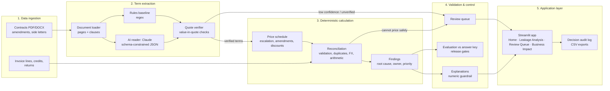

# Technical Architecture

*AI Revenue Leakage Hunter: how a contract discrepancy becomes a validated recovery action, and why each step can be trusted.*

**Design principle:** AI interprets contract language, deterministic logic calculates the money, and Finance validates recovery decisions.

## 1. Data ingestion
| Component | Module | What it does |
|---|---|---|
| Synthetic data factory | `src/generate_synthetic_data.py`, `src/contract_docs.py` | 30 contracts (PDF/DOCX) with 8 escalation wordings plus CPI, amendments, side letters and traps; invoice lines with an independent answer key. An integrity overlay adds credit notes, returns, duplicates, a currency mismatch and malformed rows |
| Document loading | `src/extract/document_loader.py` | Page-tagged text and clause segmentation |

All data is synthetic. No client data is used.

## 2. AI term extraction
| Component | Module | What it does |
|---|---|---|
| AI reader | `src/extract/llm_extractor.py`, `prompts/extract_terms.v2.md` | Reads prices, escalation, amendments and approved discounts into a Pydantic schema. The prompt treats the contract as untrusted data |
| LLM access | `src/llm/client.py` | Claude via Claude Code headless mode (`claude -p`) as one stateless turn: all tools disabled, `--safe-mode`, no saved session, empty temp working directory. Output validated against the JSON schema. Disk cache for offline replay; provenance recorded per run |
| Rules baseline | `src/extract/rule_extractor.py` | Regex reader used as the honest comparison |
| Evidence check | `src/extract/document_loader.py`, `src/extract/llm_extractor.py` | Every quoted clause must appear verbatim in the document, and every extracted value must appear in its quote. Failures go to the review queue |

The AI never calculates money.

## 3. Deterministic financial calculation
| Component | Module | What it does |
|---|---|---|
| Price schedule | `src/price_schedule.py` | Effective-dated expected price: amendments, fixed or CPI escalation (floor/cap), compounding or simple, approved discounts. Unresolved terms raise instead of being guessed |
| Reconciliation | `src/reconcile.py` | Row validation, duplicates, currency and invoice-arithmetic checks, debit/credit/return adjustments, then net billed vs expected. Underbilling and overbilling are never netted |
| Findings | `src/findings.py` | Root-cause classification, owner routing, illustrative recoverability, priority |

All arithmetic uses `Decimal`. Each finding carries its clause, page, quote, invoice lines and calculation.

## 4. Validation and control
| Control | Where | What it guarantees |
|---|---|---|
| Review queue | `src/reconcile.py`, app *Review Queue* | Lines that cannot be priced safely (invalid input, duplicates, currency mismatch, arithmetic, adjustments, undeterminable terms) are never counted as matches or leakage |
| Human decision | app *Review Queue* | Finance validates each finding; decisions are appended to `data/output/review_decisions.csv` with reviewer, reason and time |
| Explanation guardrail | `src/explain.py` | AI narratives may not introduce numbers absent from the calculation; otherwise a template is used |
| Evaluation | `src/evaluate.py`, `src/evaluate_extraction.py` | Line-level recall, precision and $ error against the answer key; field accuracy by wording style |
| Release gates | `docs/release_gates.md`, `src/build_all.py` | `python -m src.build_all --check` exits with an error if the AI path misses the acceptance thresholds |
| Tests and vetting | `tests/`, `vetting/` | 100 automated tests and a 43-case vetting checklist |
| Oracle separation | `src/pipeline.py` | Answer-key runs are labelled `ORACLE` and cannot be mistaken for detector results |

## 5. Application layer
| Page | Audience | Purpose |
|---|---|---|
| Home | CFO, O2C leadership | Business problem, illustrative opportunity, audiences, how it works |
| Leakage Analysis | Revenue assurance, O2C | Prioritised findings with contract evidence and calculation |
| Review Queue | Finance analysts | Validate, investigate or close each finding; data exceptions |
| Business Impact | Finance leadership | Detected vs validated vs recovered value, kept separate |
| End-to-End Flow | All | Contract terms to validated recovery action; built vs pilot steps |
| Technical Architecture | AI / technology teams | This document, AI vs rules comparison, evaluation scorecard |

Run with `.\scripts\tasks.ps1 app` (live) or `.\scripts\tasks.ps1 offline` (cached AI responses only).

## 6. Not in the PoC (pilot scope)
- Billing correction and rebilling in the ERP.
- Tracking the corrected invoice, receivable and cash receipt.
- Measuring cash actually recovered.
- Real client contracts and data, under the client's data terms.
